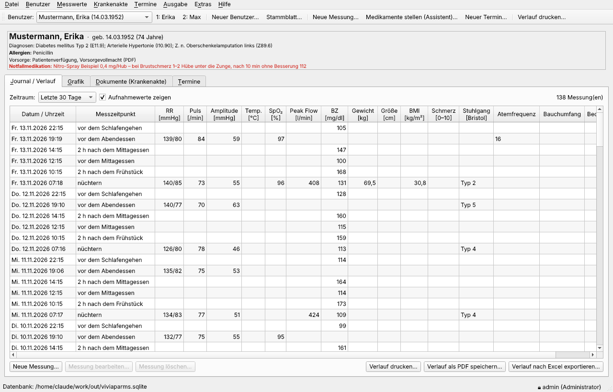

# ViviaParms

Tagebuch für Vitalwerte mit Verlauf, Grafiken, Druck (DIN A4), PDF- und Excel-Export.
Qt 6 / C++17 / qmake – quelloffen unter der PolyForm Noncommercial License 1.0.0.

> **Kein Medizinprodukt.** ViviaParms ist ein persönliches Tagebuch für gesundheitsbezogene
> Messwerte. Es stellt keine Diagnosen und ersetzt keine ärztliche Beratung.
> Die Verwendung erfolgt auf eigene Gefahr.



*Hauptfenster mit Journal (erfundene Beispieldaten).*

> **Neuer Name, neue Lizenz (ab 0.32.0):** Das Programm hieß bis Version 0.31.4 **VitaParms** und
> erschien unter der MIT-Lizenz. Es heißt jetzt **ViviaParms** und steht unter der **PolyForm
> Noncommercial License 1.0.0** (siehe [Lizenzhinweise](#lizenzhinweise)). Umstieg siehe
> [Von VitaParms auf ViviaParms umsteigen](#von-vitaparms-auf-viviaparms-umsteigen).

> **Neu: ViviaParms light** – eine vereinfachte Ausgabe für eine einzelne Person, gebaut aus demselben
> Quelltext (Unterprojekt `light/`, Desktop und Tablet/Smartphone). Siehe [ViviaParms light](#viviaparms-light).

## Funktionen

| Bereich | Umsetzung |
|---|---|
| **Stammblatt** | Name, Vorname, Geburtsdatum, Geschlecht (m/w/d), Adresse, Telefon, Mobil, Diagnosen, Bemerkungen, Allergien, Notfallkontakt, Hausarztpraxis, Krankenkasse; Angaben zu fehlenden Gliedmaßen; Vitalwerte bei Aufnahme |
| **Medikamentenplan** | gegliedert in **Regel-, Bedarfs-, Notfallmedikation und Sonstiges**; Präparat, Wirkstoff, Stärke, Form, **PZN**, Dosierschema mo-mi-ab-na, Einheit, **Einnahme-Rhythmus** (täglich, alle N Tage, an Wochentagen, monatlich) mit **Bemerkung**, **„An Einnahme erinnern“** (Tage und Uhrzeiten, je Uhrzeit eine Terminserie in der Terminliste), Hinweise, Grund, **Zeitraum von–bis** (Standard: dauerhaft, ohne Enddatum; nach Ablauf des Enddatums wandert das Medikament automatisch in die **Historie** und aus dem aktuellen Plan); **Absetzen** mit Datum (auch vorgemerkt für ein künftiges Datum) und Grund – das Medikament wandert ins Archiv, die Historie bleibt erhalten, druckbar; per Klick auf die Spaltenköpfe **auf-/absteigend sortierbar** – nur innerhalb der jeweiligen Art, ohne Umverteilung |
| **Medikamente suchen** | **BtM**, **Schmerzmittel**, **Blutverdünner/Antikoagulanzien**, **Blutdrucksenker**, **kortisonhaltige Präparate** (oder Freitext) im aktuellen Plan – mit Dosierung, Einnahme, **Menge und Wirkstoffmenge pro Tag**; druckbar/PDF |
| **Beipackzettel** | je Medikament im Internet nachschlagen (Apotheken Umschau per PZN, Gelbe Liste, Websuche, EMA, openFDA) und anzeigen; Original-PDF per Link oder Datei laden und **verschlüsselt in der Krankenakte** speichern |
| **Benutzer** | beliebig viele, Auswahl über die Werkzeugleiste; **Hauptbenutzer 1 und 2** per `Strg+1` / `Strg+2`; *Benutzer → Drucken*: Stammblatt, Medikamentenliste, Erinnerungen (anstehende Termine) |
| **Messung erfassen** | Kopfzeile mit Name/Vorname/Geburtsdatum aus dem Stammblatt; Datum/Uhrzeit vorbelegt und änderbar; Messzeitpunkt für **Tagesprofile** (nüchtern, 2 h nach dem Frühstück …, Liste editierbar); „Speichern & weitere Messung“ für Serien; **Minutenuhr** neben „Atemfrequenz“ (Start- und Endton) zum Zählen der Atemzüge |
| **Vitalwerte** | Puls, Blutdruck sys/dia, Körpertemperatur, SpO₂, **Peak Flow** (l/min), Blutzucker (mg/dl oder mmol/l), Gewicht, Körpergröße (bei neuen Messungen mit der bekannten Größe vorbelegt), **Blutdruckamplitude** (Pulsdruck, berechnet), **BMI automatisch** – bei fehlenden Gliedmaßen korrigiert (Osterkamp 1995), **Schmerzstärke** 0–10 (NRS, eigene Spalte und Kurve; ab 0.28), Beobachtungen; Beispiel-Zusatzfeld Atemfrequenz; **Peak-Flow-Warnhinweise** (grün/gelb/rot) bezogen auf den persönlichen Bestwert oder den Sollwert nach ERS 1994 (biologisches Geschlecht, Alter, Größe); **Stuhlgang** (Häkchen + Art nach der **Bristol-Stuhlformen-Skala**, Menge, Farbe, Beimengungen/Geruch, Begleitsymptome) mit **Hinweis nach drei Tagen ohne Stuhlgang** und bei schwarzem/blutigem Stuhl; **INR** mit ärztlichem Zielbereich (Hinweise unter/über dem Bereich, ab 5,0 deutlich); **Ein- und Ausfuhr** in ml mit Art und Tagesbilanz, Trinkmenge mindestens/höchstens und **Gewichtskontrolle** (z. B. > 2 kg in 3 Tagen bei Herzschwäche); **Ödeme** Grad 0–4 mit Ort und Seite (Hinweis bei einseitiger Beinschwellung, Gesicht, Grad 3–4) |
| **BZ-Tagesprofil** | *Messwerte → BZ-Tagesprofil…*: sieben Zeitpunkte (nüchtern vor dem Frühstück … vor dem Zubettgehen) mit einstellbaren Uhrzeiten; je Zeitpunkt ein Termin, zum Zeitpunkt öffnet sich direkt das Erfassungsfenster mit Betreff, Uhrzeit und Messzeitpunkt; offene Zeitpunkte nachholen über *Messwerte → Offene Tagesprofil-Messung erfassen…* oder Doppelklick auf den Termin |
| **RR-Tagesprofil** | *Messwerte → RR-Tagesprofil…* (ab 0.28): sechs Zeitpunkte (morgens vor den Tabletten … vor dem Zubettgehen) für Blutdruck und Puls, sonst wie das BZ-Tagesprofil; Auswertung *Ausgabe → RR-Tagesprofile…* mit Tagesmittelwerten |
| **Journal / Verlauf** | alle Werte, nach Datum absteigend (aktuellste zuerst), mehrere Messungen pro Tag, Zeitraumfilter |
| **Grafik** | Tages-, Wochen-, Monats-, **Jahresverlauf** und freier Zeitraum (Wahl wird gespeichert); ab gut zwei Monaten **Tageswerte** (Mittelwert, Strich = Min–Max); Bereiche wählbar, **jede Kurve einzeln ein-/ausblendbar** (Klick auf die Legende oder Menü *Kurven*); Druck/PDF wahlweise **je Bereich eine Seite**; **Stuhlgang-Häufigkeit** als Tagesbalken (nach Bristol-Typ gefärbt, Zeitspannen ohne Stuhlgang hinterlegt); **INR** mit Zielbereich als Band; **Tagesbilanz** (Ein-/Ausfuhr als Balken, Bilanz, Trinkmengen als Linien; Tagesansicht aufsummiert); **Ödeme** Grad 0–4; farblich unterscheidbar **und** mit unterschiedlichen Markerformen (auch bei Farbfehlsichtigkeit lesbar), Legende, Tooltips |
| **Ausgabe** | **Verlauf drucken** je Wertegruppe chronologisch (Zeitraum und Gruppen wählbar, mit Mittel/Min/Max); Druck und Druckvorschau auf **DIN A4**, **PDF**, **Excel (.xlsx)** mit eingebetteter Grafik, Kennwerten (Min/Max/Mittel) und Rohdaten; **Stuhlprotokoll** (Datum & Uhrzeit, Menge, Konsistenz Typ 1–7, Farbe, Beimengungen/Geruch, Begleitsymptome; Tage ohne Stuhlgang), **BZ- und RR-Tagesprofile** (aus den Messungen zusammengestellt, je Tag nach Profilzeitpunkten) und **Ein- und Ausfuhr (Bilanz)** mit Tagessummen für die aktive Person |
| **Krankenakte** | PDF-Dokumente (Befunde, Laborwerte, Entlassbriefe …) je Benutzer nach Datum archivieren; Fotos/Scans (JPG, PNG, TIFF) werden beim Import in PDF umgewandelt; Drag & Drop; Vorschläge für Datum, Art und Titel; Dubletten-Erkennung; **Volltextsuche** im PDF-Inhalt; Vorschau; **selektiver Druck**; Inhaltsverzeichnis drucken; **auf dem Tablet**: ansehen, suchen, mit der Kamera fotografieren (mehrere Seiten → ein PDF), Dateien übernehmen, teilen; beim Abgleich gehen die Inhalte **getrennt und nur bei Bedarf** |
| **Akte versenden** | ausgewählte/gefilterte/alle Dokumente plus Stammblatt, Medikamentenplan, Verlauf und Grafik als **ZIP mit Inhaltsverzeichnis**; optional **AES-256-verschlüsselt**; E-Mail mit Anhang im Standard-Mailprogramm |
| **Datenschutz** | Datenbank **vollständig verschlüsselt** (SQLite3 Multiple Ciphers, ChaCha20-Poly1305) inkl. aller Dokumente; Sicherungen ebenfalls verschlüsselt |
| **Anmeldekonten** | Anmeldung beim Start; beliebig viele Konten mit den Rollen **Administrator** und **Anwender**; nach korrekter Anmeldung wird die Datenbank ohne Schlüsseleingabe entsperrt; Wiederherstellungsschlüssel für den Notfall; Abmelden/Sperren (`Strg+L`) |
| **Termine** | **Erinnerung an den Quartalswechsel** (KV-Karte in den Praxen einlesen lassen: zwei Tage vor bis zwei Tage nach dem Wechsel, bis bestätigt; abschaltbar); Terminplaner je Benutzer (Tag/Woche/Monat/alle kommenden), Kalender mit Prioritätsmarken; **Prioritäten** niedrig/normal/hoch/dringend; Anlegen, Bearbeiten, Löschen, Erledigt; **Terminserien** (täglich, werktags, wöchentlich an Wochentagen, monatlich am Tag/n-ten/letzten Wochentag, jährlich; mit Intervall und Ende); **iCalendar-Export** (.ics) für Kalender-Apps; Administratoren sehen alle Termine, Anwender nur eigene; **beim Programmstart** Hinweisfenster mit den Terminen der gewählten Person für heute und morgen (abschaltbar) |
| **Erinnerungen** | Vorwarnung einstellbar (zum Termin … 1 Woche vorher), **optisch** (Hinweisfenster mit „Später erinnern“), **akustisch** (Gong) und/oder **per E-Mail** (SMTP mit STARTTLS/SSL); verpasste Erinnerungen erscheinen nach dem nächsten Anmelden |
| **Medikamente stellen** | Assistent liest die aktuelle Medikamentenliste mit **wählbarer Stimme (weiblich/männlich)** vor – Präparat, Dosis, Zeitpunkt; „**Weiter**“ zum nächsten, „**Wiederholen**“ für dasselbe Medikament; Filter nach Zeitpunkt (morgens …); am Ende optischer und akustischer Hinweis **„Medikamente sind gerichtet“**; **Protokoll „gestellt am/von“** mit Druck/PDF |
| **Automatische Sperre** | nach 10/20/30/60 Minuten ohne Benutzung (Einstellungen) |
| **Sprachen** | Deutsch und Englisch, Auswahl in den Einstellungen (oder Systemsprache) |
| **Themes** | alle Qt-Styles der Plattform sowie „Dark“ und „Visual Studio Code Dark“ aus AmigaED 4.0 – sofort umschaltbar |
| **Daten** | Sicherung/Wiederherstellung, **automatische Sicherung** (beim Beenden bzw. täglich, die letzten n Stände, Ordner wählbar), mehrere Datenbanken möglich |
| **Demo** | *Hilfe → Demo-Datenbank starten*: zweites Fenster mit einer erfundenen Person und **365 Tagen** Messwerten bis heute, Medikamentenplan, Terminen und Befunden; eigene verschlüsselte Datenbank und eigene Einstellungen, bei jedem Start neu erzeugt (auch `ViviaParms --demo`) |
| **Website** | *Extras → Website…*: die Daten **aller Personen** (gesamter Messwert-Verlauf mit Verlaufskurven, Medikamente, Termine, Berichte als PDF/Excel – **ohne Krankenakte**) auf der eigenen Website, geschützt durch ein Master-Passwort; Ende-zu-Ende-verschlüsselt (AES-256, Entschlüsselung erst im Browser), automatisch aktualisiert (*Datei → Website aktualisieren*, `Strg+Umschalt+U`). Siehe `website/README.md` |
| **Übertragen** | *Datei → Datenbank exportieren* (eine `.vpdb`-Datei mit Datenbank und Anmeldekonten) und **Import bei der Anmeldung** (*Datenbank importieren…*, auch beim ersten Start, am Computer und auf dem Tablet) – ohne Website, z. B. per USB-Kabel; **Datei → Datenbank der Light-Version importieren…** übernimmt die Person aus ViviaParms light als weitere Person (vorher automatische Sicherung, erneuter Import ohne Dubletten) |
| **Tablet** | **Tablet-App für Android** (Qt Quick, `mobile/`): Messungen erfassen (Messzeitpunkt auch als Freitext), Verläufe, Kurven, Stammblatt, Medikamentenplan, Kontakte und Vorsorge bearbeiten (Vorsorge-PDF aus der Krankenakte verknüpfen), **Medikamente stellen** mit Vorlesen, **Bestand und Bestellungen**, **Wunddokumentation** mit Kamerafoto, **Berichte** öffnen/teilen (auch als verschlüsseltes ZIP), **Website aktualisieren**, **Terminplaner** mit Serien, **BZ-Tagesprofil**, Quartalswechsel-Erinnerung und **Erinnerungen als Android-Benachrichtigung** – mit derselben verschlüsselten Datenbank; **Abgleich** über die eigene Website (*Datei → Datenbank abgleichen*, `Strg+Umschalt+A`) oder direkt **über das USB-Kabel** (*Datei → Mit Tablet über USB abgleichen…*, per `adb`; auch Computer → Tablet bzw. Tablet → Computer ersetzen), zeilenweises Zusammenführen. Siehe `mobile/README.md` |
| **Bestand** | *Benutzer → Medikamentenbestand und Bestellungen*: Packungen mit Stückzahl und **Verfallsdatum**, Abbuchung beim **Stellen** (zuerst ablaufende Packung), Reichweite nach Dosierschema und Rhythmus, **Bestellen bis** = Reichweite − Vorlauf (Standard 7 Tage, Wochenende → Freitag), Warnung „ist fast aufgebraucht – bitte Verordnung besorgen und bestellen!“, gespeicherte **Bestelllisten** (Druck/PDF), Erinnerung bis zur Bestätigung „bestellt“, Lieferung bucht ein |
| **Impfpass** | Im Stammblatt (Reiter *Impfpass*): erhaltene Impfungen mit Datum, „Impfung gegen“, Impfstoff, **Chargennummer**, Arzt/Praxis und Bemerkung – hinzufügen, ändern, entfernen, drucken; auch im Stammblatt-Ausdruck, in der Tablet-App (bearbeitbar) und auf der Website. Ersetzt nicht den amtlichen Impfausweis |
| **Kontakte** | Im Stammblatt (*Weitere Angaben: Kontakte*): beliebig viele Kontakte – **Krankenkasse mit Versichertennummer**, Hausarztpraxis, Fachärzte, Kliniken, Pflegedienst, Apotheke, Notfallkontakt, **Angehörige**, Sonstige –, je mit Anschrift, Telefon, Mobil, E-Mail und Website; **scrollbare Liste mit Suchfeld**, *Hinzufügen / Bearbeiten / Entfernen*. Die früheren Zusatzfelder (Krankenkasse, Hausarztpraxis, Praxis-Telefon, Notfallkontakt) werden automatisch übernommen und für ältere Versionen weiter mitgeschrieben. Anzeige im Stammblatt-Ausdruck, auf Apotheken- und Bestellliste, auf der Website und im Tablet |
| **Wunddokumentation** | *Benutzer → Wunddokumentation…* (`Strg+Umschalt+W`), nach dem Expertenstandard „Pflege von Menschen mit chronischen Wunden“: **Wunde** mit Wundanamnese (Wundart mit Klassifikation – Dekubitus-Kategorie EPUAP/NPIAP, Wagner-Grad, Verbrennungsgrad –, Diagnose, Lokalisation, Entstehung, **bei Aufnahme vorhanden**, Rezidive, Einschränkungen, Selbstmanagement, Therapieziel, Einwilligung zur Fotodokumentation), **Chronik** aus Wundbeurteilungen (Größe L×B×T, Taschen, Wundgrund in %, Exsudat, Geruch, Wundrand, Umgebung, Infektionszeichen, Schmerz, Phase, Versorgung, **Foto**) und Verbandwechseln (Handzeichen, Beschreibung, Tendenz), **Flächenverlauf**, Hinweise (Beurteilung nach 4 Wochen fällig, Infektionszeichen, Verschlechterung, Verbandwechsel fällig), Druck/PDF/Excel; **Wunden bei Aufnahme** im Stammblatt; auch auf dem Tablet (Reiter „Wunden“, Foto mit der Kamera) |
| **Vorsorge** | Im Stammblatt (*Pflege, Ausweis und Vorsorge*): **Patientenverfügung, Vorsorgevollmacht, Betreuungsvollmacht** – je vorhanden ja/nein, eingetragene Person mit Anschrift und Telefon, gültig bis; jeweils **PDF hinterlegbar** (verschlüsselt in der Krankenakte); Anzeige im Kopf, im Stammblatt-Ausdruck, auf der Website und im Tablet |
| **Apotheke** | *Medikationsliste für die Apotheke*: alle aktuellen Medikamente mit Wirkstoff und PZN, dazu Gewicht, Allergien, Diagnosen, Ankreuzliste für frei verkäufliche Mittel und Platz für Notizen – damit die Apotheke Wechselwirkungen prüft (ViviaParms selbst prüft bewusst nicht; Hinweis auf die Medikationsberatung bei Polymedikation). Desktop, Website und Tablet |
| **Pflege** | **Pflegegrad** (mit nächster Überprüfung) und **Schwerbehindertenausweis** (GdB, Merkzeichen G, aG, B, H, Bl, Gl, TBl, RF, 1. Kl., Gültigkeit) im Stammblatt, im Kopf des Hauptfensters, im Ausdruck, auf der Website und in der Tablet-App |
| **Hilfe** | **Handbuch** unter *Hilfe → Handbuch* bzw. `F1` in der Programmsprache: unter Windows als **Windows-Hilfe (.chm)** mit Inhalt, Stichwortverzeichnis und Volltextsuche, sonst als PDF im Standardanzeiger; Dateien in `<Programmordner>/docs`. Kurzanleitung **Erste Schritte** (*Getting Started*) mit Beispielen unter *Hilfe → Erste Schritte*, im Anmeldedialog, beim ersten Start und in der Tablet-App (*Einstellungen*) – auch ohne Anmeldung. Beim allerersten Start wählt man die **Sprache** (Desktop und Tablet) |
| **Formulare** | Stammblatt, Messung und Medikament sind **Qt-Designer-Dateien, die zur Laufzeit geladen werden** – vom Benutzer veränderbar, inkl. eigener Felder ohne Neuübersetzen |

## Handbuch

Zu ViviaParms gibt es ein bebildertes Benutzerhandbuch als LaTeX-Projekt (pdfLaTeX, KOMA-Script),
auf Deutsch (*ViviaParms-Handbuch*) und auf Englisch (*ViviaParms-Manual*), jeweils mit fertigem PDF.

**Im Programm (ab 0.7.7):** *Hilfe → Handbuch* (`F1`) öffnet das Handbuch in der Programmsprache aus dem
Ordner `docs` neben dem Programm (macOS: `ViviaParms.app/Contents/Resources/docs`, Linux nach `make install`:
`/usr/local/share/viviaparms/docs`). qmake kopiert `docs/` beim Bauen automatisch neben das Programm.

| Datei | Verwendung |
|---|---|
| `docs/ViviaParms-Handbuch.pdf`, `docs/ViviaParms-Manual.pdf` | alle Systeme, Standard-PDF-Anzeiger |
| `docs/ViviaParms-Handbuch.chm`, `docs/ViviaParms-Manual.chm` | Windows-Hilfe (`hh.exe`); fehlt sie, wird das PDF geöffnet |
| `docs/ViviaParms-ErsteSchritte.pdf/.chm`, `docs/ViviaParms-GettingStarted.pdf/.chm` | Kurzanleitung (*Hilfe → Erste Schritte*); die PDFs gehen auch ins Android-Paket (`assets:/docs`) |

### Erste Schritte / Getting Started

Die Kurzanleitung ist ein eigenes LaTeX-Projekt je Sprache: `ViviaParms-ErsteSchritte` (`erste-schritte.tex`)
und `ViviaParms-GettingStarted` (`getting-started.tex`), jeweils mit `Makefile` und `latexmkrc` (`make` bzw.
`latexmk -pdf`). Sie arbeitet mit der Demo-Datenbank und den Beispielpersonen Erika und Max Mustermann;
die nummerierten Markierungen in den Bildschirmfotos (`gs_*.png`) erzeugt der Testlauf.

Die CHM-Dateien entstehen aus denselben LaTeX-Quellen wie das PDF – ein Kapitel je Seite, Inhaltsverzeichnis,
Stichwortverzeichnis aus den `\index`-Einträgen, Volltextsuche; TikZ-Grafiken und Formeln als Bild:

```
python3 tools/make_chm.py ../ViviaParms-Handbuch      # → docs/ViviaParms-Handbuch.chm
python3 tools/make_chm.py ../ViviaParms-Manual        # → docs/ViviaParms-Manual.chm
python3 tools/make_chm.py ../ViviaParms-ErsteSchritte # → docs/ViviaParms-ErsteSchritte.chm
python3 tools/make_chm.py ../ViviaParms-GettingStarted # → docs/ViviaParms-GettingStarted.chm
```

Benötigt werden pandoc, pdflatex, pdftoppm und ein CHM-Compiler: `chmcmd` (Free Pascal, Debian/Ubuntu:
`sudo apt install fp-utils`) oder `hhc.exe` aus dem Microsoft HTML Help Workshop. Hinweis: Windows sperrt
CHM-Dateien aus dem Internet oder von Netzlaufwerken – ZIP vor dem Entpacken unter *Eigenschaften →
Zulassen* entsperren.

**Peak Flow (ab 0.7.4):** fester Messwert nach SpO₂ (l/min) mit eigenem Diagrammbereich. Werte aus einem
früheren Zusatzfeld „Peak-Flow“ (Formular-Eigenschaft `vpField`) werden beim ersten Öffnen der Datenbank
(Schema 6) übernommen.

**Englische Eingaben (ab 0.7.3):** Die Medikamentensuche erkennt auch englische bzw. internationale
Wirkstoffnamen (z. B. *oxycodone*, *acetaminophen*, *acetylsalicylic acid*), englische Einheiten
(*IU*, *tablets*, *puffs* …) und Darreichungsformen (*drops*, *prolonged-release*); Gründe wie *pain*
oder *migraine* werden berücksichtigt. Beim Import der Krankenakte werden Datumsangaben wie
30/09/2026, 2026-09-30, „30 September 2026“ und „September 30, 2026“ sowie englische Dokumentarten
(*discharge*, *laboratory*, *referral* …) erkannt. Die Beispielfelder der Standardformulare
(Atemfrequenz, Krankenkasse, Notfallkontakt …) erscheinen in der gewählten Sprache.

## Bauen

Voraussetzung: **Qt ≥ 6.4** mit den Modulen *Widgets, PrintSupport, UiTools* sowie *Linguist-Werkzeuge*
(`lrelease`, für die eingebettete Übersetzung). UiTools und Linguist gehören zu `qttools` und sind im
Qt-Online-Installer standardmäßig enthalten. Das Qt-Modul *SQL* wird **nicht** mehr benötigt: Die
verschlüsselnde SQLite-Variante liegt als Quelltext in `3rdparty/sqlite3mc` und wird mitübersetzt
(der erste Build dauert dadurch etwa eine Minute länger).

Empfohlen: **Qt PDF** (`pdf`, `pdfwidgets`, LGPLv3) – im Qt-Online-Installer unter
„Additional Libraries → Qt PDF“, unter Debian/Ubuntu `qt6-pdf-dev`. Damit gibt es Vorschau,
Volltextsuche und direkten Druck der Dokumente. Ohne Qt PDF baut das Projekt trotzdem
(qmake meldet die Variante); Dokumente werden dann im Standard-PDF-Programm geöffnet.

```sh
qmake6 ViviaParms.pro      # bzw. qmake aus der Qt-6-Installation
make -j                   # Windows/MSVC: nmake oder jom
```

**Qt 5.15 (ältere macOS-Versionen, 10.13–10.15):** Das Desktop-Programm übersetzt sich auch mit
Qt 5.15 – einfach das `qmake` der Qt-5-Installation verwenden (qmake meldet „Build mit Qt 5.15…“).
Die Unterschiede gleicht `src/qtcompat.h` aus (u. a. `QVariant::typeId`/`isNull`, Mausposition,
`QList(n, wert)`, Sprachausgabe-API); überladene Signale sind mit `qOverload<…>()` eindeutig.
Datenbank, Abgleich und Berichte sind identisch. Einschränkung: Qt PDF gibt es nur für Qt 6 –
in der Qt-5-Variante öffnen sich Dokumente der Krankenakte im System-PDF-Programm, Volltextsuche
und direkter Druck aus der Akte entfallen. Die Tablet-App (`mobile/`) benötigt weiterhin Qt 6.

```sh
~/Qt/5.15.2/clang_64/bin/qmake ViviaParms.pro && make -j
~/Qt/5.15.2/clang_64/bin/macdeployqt ViviaParms.app -dmg
Debian/Ubuntu: sudo apt install qtbase5-dev qttools5-dev qttools5-dev-tools qtmultimedia5-dev libqt5texttospeech5-dev
```

Ebenfalls optional:

* **Qt TextToSpeech** (`texttospeech`, LGPLv3) für das Vorlesen im Medikamenten-Assistenten.
  Gesprochen wird mit den Stimmen des Betriebssystems (Windows: SAPI/WinRT, macOS: AVSpeech,
  Linux: speech-dispatcher oder flite). Fehlt eine deutsche Stimme, liest das System mit der
  vorhandenen Stimme – der Assistent weist darauf hin. Ohne das Modul zeigt der Assistent nur an.
* **Qt Multimedia** (`multimedia`) für die Signaltöne; sonst Systempiepton.

```
Debian/Ubuntu: sudo apt install qt6-base-dev qt6-tools-dev qt6-tools-dev-tools qt6-l10n-tools \
               qt6-pdf-dev qt6-speech-dev qt6-multimedia-dev qt6-declarative-dev qmake6
               (deutsche Stimmen: speech-dispatcher-espeak-ng; qt6-declarative-dev nur wegen
                eines Header-Fehlers der Qt-6.4-Pakete von TextToSpeech)
```

**Weitergabe**

* Windows: läuft automatisch beim Build (siehe `installer/README.md`) – `windeployqt` nach jedem Build,
  beim Release-Build Installationsverzeichnis `installer/install_src` sowie, falls installiert,
  **Inno-Setup-Installer** und **Qt-Installer-Framework-Installer** in `installer/Output`
  (Ziel `C:\ViviaParms`, Sprachauswahl, Lizenz, Komponenten Programm/Handbücher, Update und Deinstallation)
* macOS: `macdeployqt ViviaParms.app -dmg`
* Linux (Debian, Ubuntu, Linux Mint, Raspberry Pi OS …): **natives Debian-Paket** mit
  `installer/debian/build_deb.sh [full|light|all]` – gebaut mit dem Qt der Distribution,
  Abhängigkeiten über `dpkg-shlibdeps`, je Distribution ein Paket
  (`viviaparms_<V>-1~deb12_amd64.deb`, `…~deb13…`, `…~ubuntu24.04…`); zu installierende Pakete und
  Ablauf in `installer/debian/README.md`. ViviaParms light zusätzlich als IFW-Installer
  (`light/installer/README.md`)

Externe Bibliotheken werden **nicht** benötigt: Diagramme (QPainter), ZIP- und XLSX-Erzeugung
sind selbst implementiert.

## Bedienung in Kürze

| Aktion | Tastenkürzel |
|---|---|
| Neue Messung | `Strg+M` / `Strg+N` |
| Messung bearbeiten / löschen | `F2` / `Entf` |
| Stammblatt | `Strg+E` |
| Neuer Benutzer | `Strg+Umschalt+N` |
| Hauptbenutzer 1 / 2 | `Strg+1` / `Strg+2` |
| Drucken / Druckvorschau | `Strg+P` / `Strg+Umschalt+P` |
| Excel-Export | `Strg+Umschalt+E` |
| Krankenakte anzeigen | `Strg+3` |
| Terminplaner / neuer Termin | `Strg+4` / `Strg+T` |
| Medikamente stellen (Assistent) | `Strg+Umschalt+M` |
| Medikamentenbestand und Bestellungen | `Strg+Umschalt+L` |
| Wunddokumentation | `Strg+Umschalt+W` |
| BtM im Medikamentenplan suchen | `Strg+Umschalt+B` |
| Abmelden / Sperren | `Strg+L` |
| Dokumente hinzufügen | `Strg+D` |
| Akte packen / senden | `Strg+Umschalt+S` |
| Handbuch | `F1` |

Hauptbenutzer werden über *Benutzer → Aktuellen Benutzer als Hauptbenutzer 1/2 festlegen* oder
*Extras → Einstellungen* belegt. Drucken/PDF/Excel beziehen sich auf den gerade sichtbaren Reiter
(Journal oder Grafik).

Kommandozeile: `ViviaParms --database <datei.sqlite>` öffnet eine bestimmte Datenbank, `ViviaParms --demo` die Demo-Datenbank.

## Termine und Erinnerungen

Reiter **Termine** bzw. Menü *Termine*. Jeder Termin gehört einem **Anmeldekonto** („Zuständig“) und kann
einer Person zugeordnet werden. Anwender sehen und bearbeiten nur ihre eigenen Termine; Administratoren
sehen alle (Filter „Alle Konten“/„Konto: …“) und können Termine anderen Konten zuweisen.

Die Erinnerung wird zum eingestellten Vorlauf ausgelöst, solange ViviaParms läuft und das zuständige
Konto angemeldet ist; verpasste Erinnerungen (bis 6 Stunden nach Terminbeginn) folgen nach der Anmeldung.

* **optisch** – Hinweisfenster unten rechts, immer im Vordergrund, Farbbalken nach Priorität;
  „Später erinnern“ (5–60 min), „Öffnen…“, „Erledigt“
* **akustisch** – Gong (`resources/sounds/reminder.wav`, austauschbar)
* **per E-Mail** – ein Administrator richtet unter *Extras → Einstellungen → E-Mail-Versand* den
  Postausgangsserver ein (Zugangsdaten liegen verschlüsselt in der Datenbank, Test-E-Mail möglich).
  Mit Passwort wird nur über STARTTLS/SSL angemeldet. E-Mails selbst sind in der Regel **nicht**
  Ende-zu-Ende-verschlüsselt; deshalb enthalten sie standardmäßig nur Titel, Zeit und Priorität.

### Erinnerung an die Einnahme von Medikamenten

Im Medikament-Formular (*Stammblatt → Medikamente*, Tablet: *Medikamente*) legt der Haken **„An Einnahme
erinnern“** für jede gewählte Uhrzeit (morgens, mittags, abends, zur Nacht – vorbelegt nach dem
Dosierschema, Uhrzeiten änderbar) eine Terminserie mit Erinnerung zum Zeitpunkt an. Bei täglicher
Einnahme sind die **Wochentage** wählbar, bei anderem Rhythmus (alle N Tage, wöchentlich, monatlich)
gelten die Einnahmetage des Rhythmus. Ändert sich das Medikament, werden die künftigen Termine erneuert;
Haken entfernen, Archivieren oder Löschen beendet sie (vergangene bleiben stehen). Für Bedarfs- und
Notfallmedikation gibt es keine Erinnerung. Die Tablet-App legt die Termine an, die Erinnerung selbst
zeigt das Programm am Computer.

### Termine beim Start, Erinnerungen drucken

Beim Programmstart zeigt ViviaParms die offenen Termine der gewählten Person für **heute und morgen**
(einschließlich Medikamententermine) – mit *Drucken…* und *Terminplaner öffnen*. Abschaltbar im Fenster
selbst oder unter *Einstellungen*; jederzeit erneut über *Termine → Termine heute und morgen…*.

*Benutzer → Drucken → Erinnerungen…* druckt die anstehenden, offenen Termine der Person (heute und morgen,
7/14/30/90 Tage oder alle kommenden; Medikamententermine wahlweise) nach Tagen gegliedert mit Zeit,
Priorität, Ort, Notiz, Zuständigkeit und Erinnerung – als Vorschau/Druck oder PDF.

### Terminserien

Im Termindialog unter **Wiederholung**: täglich, **alle … Tage** (z. B. alle 2 Tage), werktags (Mo–Fr), wöchentlich an beliebigen Wochentagen,
**alle … Wochen (am Wochentag)** (z. B. alle 3 Wochen am Mittwoch),
monatlich (am gleichen Tag, am n-ten oder am letzten Wochentag), jährlich – jeweils mit Intervall
(„alle 2 Wochen“) und Ende (ohne Ende, bis Datum, nach Anzahl). Die Vorschau zeigt die nächsten Termine.

Jedes Vorkommen ist ein eigener Termin mit eigener Erinnerung und eigenem „Erledigt“. Serien ohne Ende
werden laufend etwa 13 Monate im Voraus angelegt. Beim Ändern oder Löschen eines Serientermins fragt
ViviaParms nach dem Umfang: **nur dieser Termin**, **dieser und alle folgenden** oder **alle Termine der
Serie**. In der Liste sind Serientermine mit ↻ markiert.

### Export als iCalendar (.ics)

*Termine → Termine exportieren* bzw. Schaltfläche **iCal-Export…**: ausgewählter Termin/Serie, aktuelle
Ansicht, alle kommenden oder alle Termine – als Datei speichern oder als Anhang im Mailprogramm. Die Datei
folgt RFC 5545 und lässt sich in Outlook, Thunderbird, Apple- und Google-Kalender importieren:
Serien als Wiederholungsregel (RRULE) mit Ausnahmen (EXDATE) und einzeln geänderten Terminen
(RECURRENCE-ID), Zeitzone mit Sommerzeitregeln (VTIMEZONE), Vorwarnungen als Kalender-Alarm.
Ort, Person und Notiz werden nur auf Wunsch übernommen – die Datei ist **nicht verschlüsselt**.
Ein erneuter Import aktualisiert die Termine (feste UIDs), statt sie zu verdoppeln.

## Medikamentenplan: Art, Rhythmus, Bemerkung

Jedes Medikament gehört zu einer **Art**: *Regelmedikation* (feste Einnahme nach Plan), *Bedarfsmedikation*,
*Notfallmedikation* oder *Sonstiges* (z. B. Salben, Augentropfen, Nahrungsergänzung, Impfungen, Hilfsmittel). Stammblatt, Ausdruck und Assistent sind danach gegliedert; die Notfallmedikation
erscheint zusätzlich rot im Kopf des Hauptfensters.

Für die Regelmedikation gibt es den **Einnahme-Rhythmus**: täglich, alle N Tage, an bestimmten Wochentagen
(auch „alle 2 Wochen“), monatlich – gezählt ab einem Starttag. Dazu eine **Bemerkung** (z. B. „21 Tage Einnahme,
dann 7 Tage Pause“, „nur mittwochs! Folsäure am Donnerstag“); bei Bedarfs- und Notfallmedikation dient sie als
„Anlass“. Der Dialog zeigt die nächsten Einnahmetage an.

**An Einnahme erinnern:** siehe [Erinnerung an die Einnahme von Medikamenten](#erinnerung-an-die-einnahme-von-medikamenten).
Medikamente mit nicht täglichem Rhythmus, die vor 0.10.2 automatisch in der Terminliste standen, behalten ihre Erinnerung.

## Medikamente suchen: BtM, Schmerzmittel, Blutverdünner, Blutdrucksenker, Kortison

*Benutzer → Medikamente suchen* (BtM: `Strg+Umschalt+B`) oder im Stammblatt *Medikamentenplan → Suchen…*
listet alle in Frage kommenden Medikamente des aktuellen Plans – gegliedert nach Regel-, Bedarfs-,
Notfallmedikation und Sonstigem – mit Dosierschema, Rhythmus/Bemerkung, **Menge pro Tag** (z. B. „3 Stück pro Tag“) und
**Wirkstoffmenge** (Stärke × Menge, z. B. „1.800 mg pro Tag“; bei Intervall-Medikamenten „pro Einnahmetag“,
bei Bedarf „je Bedarfsfall“). Optional mit abgesetzten Medikamenten, Freitextsuche, Druck und PDF.

Die Zuordnung erfolgt anhand von Wirkstoff- **und** Handelsnamen (z. B. Oxycodon/Targin, Apixaban/Eliquis,
Phenprocoumon/Marcumar):

* **BtM** nach Anlage III BtMG einschließlich der *ausgenommenen Zubereitungen*: Codein/Dihydrocodein bis
  100 mg je Einheit, Tilidin nur als Retardtablette mit Naloxon, Diazepam bis 10 mg, Lorazepam bis 2,5 mg,
  Zolpidem bis 8,5 mg u. a. sind kein BtM. Medizinal-Cannabis und Dronabinol sind seit dem MedCanG (04/2024)
  keine BtM mehr, Nabilon weiterhin.
* **Schmerzmittel**: Opioide, NSAR/Coxibe, Metamizol, Paracetamol, Triptane u. a.; zusätzlich Medikamente, deren
  Grund/Indikation „Schmerz“, „Migräne“ oder „Neuralgie“ nennt (als „ggf.“).
* **Blutverdünner**: Vitamin-K-Antagonisten, DOAK, Heparine, Fondaparinux, Thrombozytenaggregationshemmer
  (ASS bis 160 mg als TAH, höher dosiert als Schmerzmittel).
* **Blutdrucksenker**: ACE-Hemmer, Sartane (auch unbekannte Wirkstoffe auf „-pril“/„-sartan“), Calciumantagonisten,
  Betablocker, Thiazide, Aliskiren u. a.; Schleifen-/kaliumsparende Diuretika, Alphablocker, Clonidin, Minoxidil
  und Sacubitril als „ggf.“ (auch andere Anwendungsgebiete), ebenso Grund „Bluthochdruck“.
* **Kortisonhaltige Präparate** (Glukokortikoide) mit Anwendungsart aus der Darreichungsform: systemisch,
  inhalativ, nasal, äußerlich (Haut), Augen/Ohren, rektal.

„ggf.“ markiert Fälle, die von Zubereitung oder Stärke abhängen. Jede Zuordnung lässt sich im
Medikamentendialog unter **Kennzeichnung** korrigieren (gespeichert wird nur die Abweichung). Hinweise:
mehrere NSAR, mehrere Gerinnungshemmer bzw. mehrere RAS-Hemmstoffe gleichzeitig werden markiert; bei systemischem Kortison Hinweis auf Notfallausweis/nicht eigenmächtig absetzen. Ohne Gewähr.

## Beipackzettel

Im Medikamentenplan (Stammblatt), im Medikamentendialog und im Assistenten: **Beipackzettel…**

* **PZN** von der Packung eintragen (Prüfziffer wird kontrolliert) – damit findet *Apotheken Umschau* den
  Beipackzettel genau dieses Präparats (öffnet im Browser, mit Link zur Original-Gebrauchsinformation).
* *Gelbe Liste* und *Websuche* nach Name; eigene Quellen als URL-Vorlage unter *Einstellungen*.
* **EMA-Produktinformation** (PDF mit Packungsbeilage, nur zentral zugelassene Arzneimittel) und
  **openFDA** (US-Information, englisch) werden direkt im Fenster angezeigt.
* **Adresse laden… / Aus Datei…**: Original-PDF (z. B. den Link „Original Beipackzettel“) abrufen, anzeigen,
  drucken und **in der Krankenakte speichern** – verschlüsselt, mit dem Medikament verknüpft, offline verfügbar.

Übertragen werden nur Name, Stärke, Wirkstoff bzw. PZN – keine Personendaten. Das Nachschlagen im Internet
lässt sich in den Einstellungen abschalten. Maßgeblich ist immer der Beipackzettel in der Packung.

## Medikamente stellen

*Benutzer → Medikamente stellen (Assistent)…* liest die am gewählten **Tag fälligen** Medikamente der
Regelmedikation (nicht archiviert, gültig, Rhythmus beachtet) nacheinander vor – Datum wählbar, z. B. Tag für
Tag beim Befüllen eines Wochendosierers. Nicht fällige, Bedarfs- und Notfallmedikamente werden darüber
angezeigt. Vorgelesen werden – alphabetisch nach Präparat (wie Medikamentenplan und Stell-Liste):
Präparat, Stärke, Form, die Dosis je Zeitpunkt sowie Rhythmus und Bemerkung. Kürzel werden ausgeschrieben (mg → Milligramm,
IE → internationale Einheiten, ½ → eine halbe, s.c. → unter die Haut).

* **Weiter ▶** (Leertaste/Eingabe/→) – nächstes Medikament; erst dann wird weitergelesen
* **↻ Wiederholen** (R) – dasselbe Medikament nochmals
* **◀ Zurück** (←) – vorheriges Medikament
* „Zeitpunkt“ beschränkt auf morgens/mittags/abends/zur Nacht, z. B. für einen Wochendosierer
* Stimme: „weiblich/männlich (automatisch)“ wählt eine installierte Systemstimme der Oberflächensprache;
  zusätzlich lässt sich jede installierte Stimme gezielt auswählen (im Assistenten oder unter
  *Einstellungen*, dort auch das Sprechtempo). Da manche Sprachausgaben das Geschlecht ihrer Stimmen
  falsch melden (flite: alle „männlich“), erkennt ViviaParms bekannte Stimmen zusätzlich am Namen.
  Fehlt eine Stimme des gewünschten Geschlechts, wird die Tonhöhe der vorhandenen Stimme verändert und
  der Assistent weist darauf hin – eine echte männliche Stimme muss im Betriebssystem installiert sein.

Nach dem letzten Medikament erscheint groß **„✔ Medikamente sind gerichtet“** mit Signalton und Ansage.

**Protokoll:** Jeder Durchgang wird mit Zeitpunkt, angemeldetem Konto, Tageszeit und den gestellten
Medikamenten samt Dosis protokolliert; dazu eine optionale Bemerkung (z. B. „Wochendosierer KW 43“).
Wird der Assistent vorzeitig beendet, steht der Eintrag als „abgebrochen (n von m)“ im Protokoll.
Der Assistent zeigt, wann zuletzt gestellt wurde; *Benutzer → Protokoll Medikamente stellen…* listet alle
Einträge (30 Tage … gesamter Zeitraum) zum Drucken oder als PDF. Löschen dürfen nur Administratoren.

## Website

ViviaParms kann die Daten aller Personen auf einer eigenen Website zum **Ansehen** bereitstellen –
für Angehörige, die Hausarztpraxis oder unterwegs. Die Website ist statisch (HTML/JavaScript plus
eine kleine PHP-Datei zum Hochladen) und braucht **keine Datenbank** auf dem Server.

- **Inhalt:** persönliche Angaben, Notfallmedikation, der **gesamte** Verlauf der Messwerte als
  Tabelle (CSV-Download) und als **Verlaufskurven** (Tag/Woche/Monat/Jahr/Zeitraum, Kurven ein-
  und ausblendbar, Legende, druckbar), Medikamentenplan, Termine sowie Stammblatt,
  Medikamentenplan und Verlauf als PDF/Excel zum Herunterladen. Die **Krankenakte wird nicht
  übertragen.**
- **Schutz:** ViviaParms verschlüsselt alles **vor dem Hochladen** mit dem Master-Passwort
  (PBKDF2-SHA256 mit 210 000 Iterationen → AES-256-CTR + HMAC-SHA256). Der Server speichert nur
  Chiffrat; entschlüsselt wird im Browser (Web Crypto API). Ein getrennter **Upload-Schlüssel**
  berechtigt zum Hochladen. Automatische Abmeldung nach 30 Minuten.
- **Aktualisierung:** automatisch etwa eine Minute nach Änderungen (im Hintergrund) und beim
  Beenden, oder von Hand mit *Datei → Website aktualisieren* (`Strg+Umschalt+U`).

Einrichtung: Inhalt von `website/` per (S)FTP in das Wurzelverzeichnis der (Sub-)Domain
hochladen, HTTPS einschalten, in ViviaParms *Extras → Website…* Adresse und Master-Passwort
eintragen, *Jetzt hochladen*. Details in `website/README.md` und im Handbuch (Kapitel „Die eigene
Website“).

## Tablet-App und Abgleich

Die Tablet-App (`mobile/ViviaParmsMobile.pro`, Qt Quick) teilt sich mit dem Desktop-Programm den
Kern (`core.pri`: Datenbank, Verschlüsselung, Fachlogik, Berichte, Website, Abgleich). Sie wird
mit Qt Creator für Android gebaut und als APK direkt installiert (Entwicklermodus, keine
Verteilung über Google Play) – Anleitung in `mobile/README.md`.

Abgleich: Beide Geräte tauschen die **verschlüsselte SQLite-Datenbank** samt Schlüsseldatei über
`api/sync.php` der eigenen Website aus. Jede Zeile trägt eine geräteübergreifende Kennung und
einen Änderungszeitpunkt (Trigger, Schema 7), Löschungen hinterlassen Vermerke. Beim
Zusammenführen bleiben neue Zeilen beider Seiten erhalten, bei gleicher Zeile gewinnt die jüngere
Änderung, Löschvermerke gewinnen gegen ältere Änderungen. Terminvorkommen einer Serie haben feste
Kennungen (Serie@Zeitpunkt). Der Server zählt eine Revision hoch und weist veraltete Uploads ab
(HTTP 409 → erneut einarbeiten).

Abgleich über das USB-Kabel (`usbsync.*`, `usbsyncdialog.*`): Die Tablet-App wartet auf
`127.0.0.1:47811` (nur solange die Seite „USB-Abgleich“ offen ist) und zeigt einen sechsstelligen
Code. Das Desktop-Programm leitet mit `adb forward tcp:0 tcp:47811` einen Port über das Kabel
weiter und verbindet sich. Ob beide dieselbe Datenbank verwenden, zeigt ein HMAC-Nachweis über
einen Zufallswert (der Schlüssel wird nicht übertragen). *Abgleichen*: Tablet-Datenbank holen,
hier einarbeiten (`DbMerge::mergeFrom`), Ergebnis zurückschicken, dort ebenso einarbeiten;
Anmeldekonten gelten vom Gerät mit der jüngeren `.keys`-Datei. *Ersetzen*: `.vpdb`-Paket in die
eine oder andere Richtung (bisheriger Stand bleibt als Kopie). Zum Testen ohne adb:
`VP_USBSYNC_DIRECT=127.0.0.1:47811`.

## Anmeldung, Rollen und Verschlüsselung

**Erster Start / neue Datenbank:** ViviaParms legt einen zufälligen 256-Bit-Datenbankschlüssel an,
verschlüsselt damit die Datenbank und fragt nach dem ersten **Administrator-Konto** (Name + Passwort).
Anschließend wird der **Wiederherstellungsschlüssel** angezeigt (drucken, speichern, kopieren). Eine
unverschlüsselte Datenbank einer älteren Version wird beim ersten Öffnen verschlüsselt.

**Anmeldung:** Konto + Passwort. Bei korrekter Anmeldung wird die Datenbank automatisch entsperrt –
niemand muss den Datenbankschlüssel kennen. Mehrere Konten (auch mehrere Administratoren) teilen sich
dieselbe Datenbank.

| Rolle | darf |
|---|---|
| **Anwender** | Personen anlegen/bearbeiten, Messungen und Dokumente erfassen, drucken, exportieren, Akte versenden, eigenes Passwort ändern, Einstellungen |
| **Administrator** | zusätzlich: Anmeldekonten verwalten (anlegen, Passwort setzen, Rolle wechseln, löschen), Wiederherstellungsschlüssel anzeigen, Personen löschen, Datenbanken anlegen/öffnen, Sicherung/Wiederherstellung, Formulare anpassen |

Es muss immer mindestens ein Administrator-Konto bestehen. Vergisst ein Anwender sein Passwort,
setzt ein Administrator ein neues. Vergessen alle Administratoren ihr Passwort, hilft der
Wiederherstellungsschlüssel (Anmeldedialog → *Wiederherstellungsschlüssel…*).

**Technik:**

* Datenbank: SQLite3 Multiple Ciphers 2.6.1 (MIT), Verschlüsselung ChaCha20-Poly1305 je Seite,
  sichere Löschung (`secure_delete`), temporäre Daten nur im Arbeitsspeicher.
* Schlüsseldatei `<datenbank>.keys` (neben der Datenbank): je Konto der Datenbankschlüssel,
  verschlüsselt mit PBKDF2-HMAC-SHA256 (200 000 Runden) + AES-256-CTR + HMAC-SHA256. Die Kontenliste
  ist gegen Manipulation mit einem HMAC geschützt; eine von außen veränderte Liste führt zur
  Anmeldung mit Anwenderrechten.
* Der Wiederherstellungsschlüssel ist der Datenbankschlüssel selbst (Base32 mit Prüfsumme). Er
  funktioniert auch ohne `.keys`-Datei – entsprechend sicher aufbewahren.
* **Sicherungen** bestehen aus zwei Dateien: `…sqlite` (verschlüsselt) und `…sqlite.keys`.
* **Automatische Sicherung** (ab 0.27, Desktop): beim Beenden, wenn sich etwas geändert hat, und
  beim Start, wenn die letzte älter als 24 Stunden ist. Die letzten n Stände (Standard 7) bleiben
  in `<Programmdaten>/Sicherungen` oder einem gewählten Ordner (*Extras → Einstellungen →
  Automatische Sicherung*); Dateiname `ViviaParms-Auto_<datenbank>_<datum>_<zeit>.sqlite` + `.keys`.
  Ist der Ordner nicht erreichbar, warnt ViviaParms; nach 7 Tagen ohne Sicherung deutlich.
* **Versionsschutz** (ab 0.27): Das Datenbankformat steht in `PRAGMA user_version`
  (`Database::kSchemaVersion`). Eine Datenbank aus einer neueren Version wird nicht geöffnet,
  ein Abgleich (USB oder Website) mit einem Gerät in neuerer Version abgelehnt, und der Server
  nimmt von älteren Versionen keine Datenbank mehr an (HTTP 426) – so kann ein nicht
  aktualisiertes Gerät keine Daten überschreiben, die es nicht kennt.
* **0.34.1:** **Sprachausgabe unter Android: kein falscher Hinweis mehr.** Android startet die
  Sprachausgabe verzögert und meldet bis dahin einen Fehler (je nach Qt-Version mit Ursache). ViviaParms
  hielt sie deshalb für „nicht verfügbar“ und zeigte beim Medikamente-Stellen den Hinweis, eine
  Sprachausgabe-App zu installieren – obwohl kurz darauf gesprochen wurde. Jetzt gilt sie während der
  ersten Sekunden als „wird gestartet“, ein Text wird bis dahin zurückgehalten, und die Anzeige
  (Stimmenliste, „automatisch vorlesen“, Hinweis) aktualisiert sich, sobald die Engine bereit ist. War
  sie einmal bereit, gilt ein später gemeldeter Fehler (etwa für eine nicht installierte Sprachvariante)
  nicht mehr als „keine Sprachausgabe“. Nennt die Engine bei keiner Stimme ein Geschlecht (Google:
  „de-de-x-deb-local“), wird die Standardstimme ohne Tonhöhen-Verstellung und ohne Warnung verwendet.
* **0.34.0:** **Mobil: Termine in den Kalender übertragen** – neue Einstellung (*Einstellungen →
  Kalender*): Termine gehen in einen Kalender des Telefons/Tablets, bei einem Google-Konto damit auch in
  Google Kalender. Nur in eine Richtung (ViviaParms bleibt maßgeblich; geänderte oder gelöschte
  Einträge im Kalender werden beim nächsten Übertragen wiederhergestellt), automatisch nach jeder
  Änderung, ohne Google-Anmeldung in ViviaParms. Wählbar sind *alle Termine* (alle Personen; mit dem
  Verwaltungskonto aller Konten – wie im Terminplaner) oder *nur die Termine einer Person*; dazu der
  Kalender (Vorschlag: ein Kalender „ViviaParms“). Notizen nur auf Wunsch, Ausschalten entfernt die
  Einträge wieder. Details in
  `mobile/README.md`.
* **0.33.1:** **Smartphone: Verlaufskurven wieder sichtbar** (gemeldet auf einem Moto G67). Die Seite
  *Verlaufskurven* rollt jetzt als Ganzes, statt die Kurven in einen eigenen, am Smartphone nur wenige
  Pixel (oder gar keine) hohen Bereich zu legen; die Kurvenauswahl steht dort in einer Zeile zum
  Seitwärtswischen, jede Kurve ist mindestens 260 px hoch. Dazu: die Personenliste links erscheint nur
  noch bei genug Breite **und** Höhe (Smartphone quer bekommt das volle Bild), die Kopfleiste fasst
  Einstellungen/Sperren/Beenden nach ihrer eigenen Breite im Menü ☰ zusammen, *Demo beenden* steht am
  Smartphone im Menü, die Kopfzeile ist bei wenig Höhe kompakter und Plaketten (Pflegegrad, GdB)
  brechen um statt über den Rand zu ragen. Autopilot `VP_AUTOPILOT_CHARTONLY=1` prüft die sichtbare
  Kurvenfläche und alle Reiter in sechs Bildschirmgrößen (Smartphone hoch/quer, klein, Tablet).
  **Zeitraum per Kalender:** *Von*/*Bis* bei *Verlaufskurven* und *Messwerte → Zeitraum* werden mit einem
  Monatsblatt gewählt (`DatePicker`, `CalendarPopup`). Vorher waren es Textfelder, die schon beim Tippen
  galten – ein Zwischenstand wie „01.10.20“ (= 2020) verstellte den Zeitraum und überschrieb das andere
  Feld, die Kurve zeigte danach nicht das Gewünschte. Alle übrigen Datumsfelder (`DateField`) haben
  zusätzlich einen Kalenderknopf; Tippen geht weiter. Autopilot: Von/Bis per Fingertipp im Kalender,
  Kurve und Felder folgen; Datumsfeld mit Kalender.
* **0.33.0:** **Terminserien mit eigener Uhrzeit je Wochentag** (Desktop, light, Tablet/Smartphone):
  Bei *wöchentlich* gibt es *Eigene Uhrzeit je Wochentag* – je gewähltem Wochentag „von – bis“, z. B.
  Mo 8:00–9:00, Mi 14:30–15:15, Fr 10:00 –, in einer Serie und auf Wunsch für einen Zeitraum
  (*bis einschließlich*). `Recurrence::dayTimes` (JSON `times`), die Termine werden mit der Uhrzeit
  ihres Wochentags angelegt; *Alle Termine der Serie* behält die Uhrzeiten; wird ein Termin zeitlich
  verschoben und für *folgende*/*alle* gespeichert, gilt die neue Uhrzeit für seinen Wochentag.
  Einzelne Termine lassen sich wie bisher abändern. iCalendar-Export: eine RRULE je Uhrzeit (die Gruppe
  des ersten Termins behält die UID, die übrigen `…-s<id>-w<Wochentage>`). Tests: Harness (Regel,
  Datenbank, „alle“, Verschieben, iCalendar, Formular) und Autopilot.
* **0.32.0:** **VitaParms heißt jetzt ViviaParms** und steht unter der **PolyForm Noncommercial
  License 1.0.0** (bis 0.31.4: MIT-Lizenz; für diese Fassungen gilt sie weiter). Umbenannt sind
  Programm, App, Website, Installer, Debian-Pakete, Handbücher, Projekt- und Quelldateien sowie
  Paketnamen (`de.mbergmann.viviaparms`) und Datenordner. Neu: `src/legacymigration.*` übernimmt am
  Computer beim ersten Start einmalig Einstellungen und Daten von VitaParms bzw. VitaParms light
  (Kopie, der alte Ordner bleibt); ViviaParms light findet für den Import auch noch die Datenbank von
  VitaParms light. Interne Kennungen, an denen verschlüsselte Daten, Sicherungen, Abgleich, Website
  und Kalender hängen, bleiben unverändert (siehe [Umstieg](#von-vitaparms-auf-viviaparms-umsteigen)).
  Lizenz: `LICENSE` (mit „Required Notice“), SPDX-Kennung `PolyForm-Noncommercial-1.0.0` in allen
  Quelldateien, Info-Dialog, App-Einstellungen, Installer-Lizenzseiten, Debian-`copyright`,
  AppStream (`project_license`), Manpages, Handbücher (Impressum, Anhang Recht). Test: Umzug mit
  vorgetäuschten VitaParms-Ordnern und -Einstellungen.
* **0.31.4:** ViviaParms mobile: Auswahllisten zeigten auf dem Tablet (Qt 6.12) **leere Einträge** –
  z. B. die Personenauswahl im Hochformat. `VCombo` entschied über `Array.isArray(model)`, ob ein
  Eintrag ein Objekt ist; eine Liste aus C++ ist in neueren Qt-Versionen aber kein JS-Array. Jetzt
  wird der Eintrag selbst geprüft. Autopilot öffnet die Personenauswahl im Hochformat und prüft die Namen.
* **0.31.3:** ViviaParms mobile: **Drehen des Tablets** – die Oberfläche passte sich nicht mehr an,
  beim zweiten Drehen blieb der Bildschirm schwarz (seit 0.31.2). `SystemUi` fragt die Ränder der
  Systemleisten nicht mehr ab, wenn Qt (ab 6.9) den Fensterinhalt selbst polstert – die Abfrage kam
  mitten im Größenwechsel; sonst nur noch nachträglich (queued). Symbole der Systemleisten werden nur
  bei randloser Darstellung (Android 15+) und nur bei einem Wechsel hell/dunkel umgestellt (unter
  Android 13 wären dunkle Symbole auf der dunklen Statusleiste unsichtbar gewesen). Autopilot dreht
  das Fenster viermal und prüft, dass die Oberfläche folgt.
* **0.31.2:** **ViviaParms mobile für Android 15/16 und Google Play:** Ziel-API 36 (Android 16),
  Mindestversion Android 9, qmake verlangt für Android Qt 6.10 oder neuer (16-KB-Speicherseiten).
  Darstellung bis an den Rand: Inhalt bleibt frei von Status- und Navigationsleiste (`SystemUi`,
  `src/systemui.*`), Symbole der Leisten passend zum hellen/dunklen Design (`SystemBars.java`).
  **Zurück-Taste/-Geste** schließt die geöffnete Seite wie *Abbrechen*, führt aus einem Reiter zur
  Übersicht und beendet die App erst dort (vorher beendete sie die App sofort);
  `enableOnBackInvokedCallback="false"`. Erinnerungen ohne `USE_EXACT_ALARM` (Google Play nur für
  Wecker-/Kalender-Apps): pünktlich mit `SCHEDULE_EXACT_ALARM`, ab Android 14 vom Anwender erteilt
  (*Einstellungen → Erinnerungen → Pünktliche Erinnerungen erlauben*), sonst ungefähr. Neues Skript
  `tools/check_android_16k.sh` prüft APK/AAB auf 16-KB-Speicherseiten. Autopilot: „Zurück“ und
  vorgetäuschte Systemleisten (`VP_AUTOPILOT_SAFE`). Auf Android 13 und älter ändert sich nichts.
* **0.31.1:** **App reagiert wieder flüssig** (ViviaParms mobile, vor allem Tablets): Nach jeder Änderung
  (Messung speichern, löschen, Bestand buchen …) luden bisher alle Reiter neu – auch die unsichtbaren, weil
  die Startseite die Person bei jedem Neuladen neu setzte – und das bis zu dreimal je Vorgang. Auf einem
  Tablet blockierte das die Oberfläche mehrere Sekunden („ViviaParms reagiert nicht“, Tastatur öffnete
  nicht). Jetzt: Änderungen eines Vorgangs werden gebündelt (`AppController::bump` → ein `dataChanged`
  nach Rückkehr in die Ereignisschleife), nur der sichtbare Reiter lädt sofort, die anderen beim Anzeigen
  (auch beim Personenwechsel und für die Verlaufskurven), Personenliste und Kopf werden nur bei echter
  Änderung neu aufgebaut. Messung speichern samt Neuladen: Demo-Datenbank am PC von ca. 2,5 s auf ca. 50 ms.
  Erinnerungen: unveränderter Plan wird nicht erneut an Android gegeben, die Wecker werden in einem
  Hintergrund-Thread gestellt. **Tastatur:** öffnet auch beim Antippen der Messwert-Kachel neben den Ziffern
  und beim erneuten Antippen eines Feldes, nachdem sie mit „Zurück“ geschlossen wurde.
  Messmodus `VP_AUTOPILOT_BENCH=1` im Autopiloten (Zeiten der App-Aufrufe).
* **0.31.0:** **Terminkollisions-Check** (nur ViviaParms und ViviaParms mobile, nicht light): nachträglich aufrufbar über
  *Termine → Terminkollisionen prüfen…* bzw. *Kollisionen prüfen…* im Terminplaner (App: Reiter Termine,
  „Kollisionen prüfen“, ab zwei Personen). Vergleicht die Termine von zwei oder mehr gewählten Personen in einem
  Zeitraum, meldet Überschneidungen (optional mit Mindestabstand, z. B. Fahrzeit) und schlägt je Kollision bis zu drei
  freie Ausweichtermine gleicher Dauer vor (innerhalb von 14 Tagen, Tageszeit von–bis, wahlweise nur Mo–Fr, frei für
  alle gewählten Personen); verschoben werden soll der Termin mit niedrigerer Priorität, sonst der spätere.
  Doppelklick bzw. „Termin öffnen“ bearbeitet ihn, danach wird neu geprüft. Ausdruck DIN A4 hoch, PDF.
  Ganztägige, erledigte Termine und Termine derselben Person werden nicht verglichen. `src/apptconflicts.*`,
  `src/apptconflictdialog.*`, `ReportPrinter::appointmentConflicts*`, App `ConflictsPage.qml`,
  `AppController::apptConflicts`, Export-Art `conflicts`.
* **0.30.5:** **Terminübersicht** (Reiter *Termine*): Beim Öffnen ist unter *Person* die im Hauptfenster gewählte
  Person eingestellt, die Liste zeigt nur ihre Termine; ein Personenwechsel im Hauptfenster wird übernommen.
  Die Termine aller Personen erscheinen nur mit *Alle Personen* (bisher Vorgabe).
* **0.30.4:** Medikamente stellen: Der Assistent (Computer und App) führt die Medikamente jetzt **alphabetisch
  nach Präparat** durch – wie Medikamentenplan und Stell-Liste. Bisher galt die Reihenfolge des Tages
  (zuerst, was morgens genommen wird), sodass z. B. ein Mittel nur „zur Nacht“ zuletzt kam.
* **0.30.3:** **Medikamente stellen → „Liste drucken…“** (alle Ausgaben; App: Knopf „Liste“ → PDF): nur die zu
  stellenden Medikamente des gewählten Tages/der Woche und Zeitpunkts, alphabetisch, mit Präparat, Wirkstoff,
  Stärke, Tagesgabe („1 - 0 - 1 - 0“) und Restbestand **nach** dem Stellen (Bestand minus noch nicht abgebuchte
  Stellmenge, `MedStock::pendingPreparation`; rot „fehlen …“, „—“ ohne Bestandsführung). DIN A4 hoch mit
  üblichen Druckrändern (links 25 mm, sonst 20 mm), Spaltenbreiten nach Inhalt, eine Zeile je Medikament
  (zu Langes mit „…“ gekürzt). `MedPrep::listRows`, `ReportPrinter::preparationList`/`preparationListToPdf`.
* **0.30.2:** **Kleine Bildschirme (z. B. 1366 × 768):** Alle Fenster passen sich an (`src/screenfit.*`,
  app-weiter Filter beim Anzeigen): Ist ein Dialog höher oder breiter als der freie Bildschirmbereich,
  kommt sein Inhalt in eine rollbare Fläche, die Leiste mit OK/Abbrechen bleibt darunter sichtbar (z. B.
  Einstellungen, Messung, Medikament, Termin, Wundbeurteilung); jedes Fenster wird auf den freien Bereich
  begrenzt und ganz sichtbar platziert (auch mit einer gespeicherten Größe von einem größeren Bildschirm).
  Hauptfenster: Die Bereichsauswahl der Grafik bricht um (`src/flowlayout.*`) – das Fenster ist nicht mehr
  mindestens 1 690 Pixel breit, die Werkzeugleiste zeigt überzählige Einträge hinter der Schaltfläche ».
* **0.30.1:** **Debian-Pakete (.deb)** für ViviaParms und ViviaParms light: `installer/debian/build_deb.sh`
  baut auf Debian 12/13, Ubuntu 24.04+ und Derivaten (ältere mit `--qt5`) native Pakete gegen das Qt der
  Distribution – Prüfung der Voraussetzungen mit passendem `apt`-Befehl (`--check`, `--install-deps`),
  Abhängigkeiten über `dpkg-shlibdeps`, Menüeintrag mit Aktion „Demo-Datenbank“, Symbole 16–256 px,
  AppStream-Metadaten, Manpages DE/EN, Handbücher unter `/usr/share/<programm>/docs`, lintian-sauber.
  Programm: `setDesktopFileName` (Symbol in Dock/Taskleiste, Wayland); `--help`/`--version` zeigen beim
  allerersten Start keinen Sprachdialog mehr.
* **0.30.0:** **Digitaler Impfpass** im Stammblatt (alle Ausgaben): erhaltene Impfungen mit Datum,
  „Impfung gegen“ (Vorschläge), Impfstoff (Präparat), **Chargennummer**, Arzt/Praxis und Bemerkung,
  vom Anwender editierbar – am Computer eigener Reiter *Impfpass* (`VaccinationDialog`), Ausdruck über
  den Reiter, *Benutzer → Drucken → Impfpass…* und *Ausgabe → Impfpass drucken…*, Abschnitt im
  Stammblatt-Ausdruck; Tablet/Smartphone: Abschnitt im Stammblatt mit Hinzufügen/Ändern/Entfernen,
  PDF unter *Berichte*; Website: Anzeige bei den persönlichen Angaben. Gespeichert wie die Kontakte als
  JSON-Liste (`Patient::extra["vaccinations"]`, `src/vaccinations.*`) – kein neues Datenbankformat.
  Website: Kachel „Blutdruckamplitude“ in der Übersicht nach RR und Puls.
* **0.29.0:** **Blutdruckamplitude** (Pulsdruck = systolisch − diastolisch), berechnet und nicht
  gespeichert (`VitalKey::PulsePressure`): eigene Spalte im Verlauf direkt nach RR und Puls, graue Kurve im
  Bereich „Blutdruck & Puls“, in Excel/PDF, in der Tablet-App und auf der Website – in ViviaParms und
  ViviaParms light. Datenbankformat unverändert (12). ViviaParms light: Windows-Installer mit Inno Setup
  und Qt Installer Framework wie bei ViviaParms (`light/installer/README.md`).
  **Verlauf drucken** (Druck, Vorschau, PDF; Computer, Tablet, Akte-ZIP, Website-Bericht): nicht mehr als
  gemischte Tabelle, sondern je gewählter Wertegruppe ein eigener, chronologischer Abschnitt mit
  Mittelwert/Minimum/Maximum; vorher Dialog mit Zeitraum (von–bis) und Wertegruppen
  (`HistoryPrintDialog`, `ReportPrinter::history*`). Tablet/Smartphone: **Zeitraum von–bis** in
  Verlaufskurven und Messwerten (auch für PDF, Excel, Protokolle).
* **0.28.2:** BZ-/RR-Tagesprofil am Computer: Zum Zeitpunkt öffnet sich direkt das Erfassungsfenster
  (kein Erinnerungsfenster mehr dazwischen). Offene Zeitpunkte lassen sich nachholen – *Messwerte →
  Offene Tagesprofil-Messung erfassen…* (`Strg+Umschalt+G`) oder Doppelklick auf den Termin bzw.
  *Messung erfassen…* im Reiter „Termine“.
* **0.28.1:** Personenauswahl am Computer: Die intern gewählte Person folgt jetzt jeder Änderung der
  Auswahlliste (vorher nur „activated“) – BZ-/RR-Tagesprofile und andere Aktionen gelten sicher für
  die angezeigte Person; der Tagesprofil-Dialog nennt die Person deutlich. Tablet: Reiterleiste bricht
  um, alle Seiten auch auf dem Smartphone lesbar.
* **Datenbankformat 12** (ab 0.28): neue Spalte `vitals.pain` (Schmerzstärke 0–10); Einträge aus dem
  alten Zusatzfeld „Schmerz (NRS)“ werden beim ersten Öffnen übernommen. **Alle Geräte (Computer,
  Tablet, Website-`api/`) auf 0.28 aktualisieren** – ältere Versionen öffnen die Datenbank nicht mehr.

**Grenzen (ehrlich benannt):** Die Rollen sind eine Regel innerhalb von ViviaParms. Wer mit einem
Anwenderkonto die Datenbank entsperren kann, könnte sie mit eigenen Werkzeugen auch vollständig
auslesen – die Verschlüsselung schützt vor Personen *ohne* Konto (verlorenes Notebook, Kopie der
Datei). Exporte (PDF, Excel, unverschlüsselte ZIPs) und Dateien, die zur Ansicht an andere Programme
übergeben werden, sind nicht verschlüsselt. Bei SSDs können Reste einer früher unverschlüsselten
Datenbank physisch erhalten bleiben.

## Sprache und Erscheinungsbild

*Extras → Einstellungen → Darstellung*

* **Sprache:** Systemsprache, Deutsch oder English (wirksam nach Neustart, ViviaParms bietet ihn an).
  Übersetzungsdatei: `translations/viviaparms_en.ts` (Qt Linguist). Neue Texte:
  `lupdate -no-obsolete ViviaParms.pro`, dann übersetzen (Linguist oder `translations/en_dict.py` +
  `python3 tools/apply_translations.py`). Die `.qm`-Datei erzeugt der Build automatisch.
  Eingegebene Daten (Diagnosen, Messzeitpunkte, Kategorien bestehender Dokumente) werden nicht übersetzt.
* **Theme:** „Systemstandard“, alle Qt-Styles der Plattform (z. B. Fusion, Windows, windowsvista/
  windows11, macOS) sowie **Dark (AmigaED)** und **Visual Studio Code Dark (AmigaED)** mit den
  Paletten und Stylesheets aus AmigaED 4.0. Die Umschaltung wirkt sofort; die Diagramme am
  Bildschirm passen sich dunklen Themes an, Ausdrucke bleiben auf weißem Papier.

## Digitale Krankenakte

Reiter **Dokumente (Krankenakte)**: Liste nach Dokumentdatum (neueste zuerst), Filter nach Art
und Jahr, Suchfeld über Titel, Art, Absender, Notiz, Dateiname, Datum und – sofern das PDF Text
enthält – den gesamten Inhalt. Mehrere Suchbegriffe müssen alle vorkommen; die Spalte
„Fundstelle“ zeigt den Treffer im Text.

**Import:** *Hinzufügen…* oder Dateien auf das Fenster ziehen. ViviaParms schlägt vor:
Datum aus Dateiname (`2026-09-30_…`, `20260930`, `30.09.2026`) oder Briefkopf (jüngstes
plausibles Datum, Geburtsdatum ausgeschlossen) oder PDF-Erstellungsdatum; Art anhand von
Stichwörtern (Entlass…, Labor…, Befund …); Titel aus PDF-Titel oder Dateiname. Identische
Dateien werden über SHA-256 erkannt.

**Scans ohne Text** sind nur über Titel, Art, Absender und Notiz auffindbar (Spalte „Text“ leer).
Eine Texterkennung (OCR) ist nicht eingebaut – entweder die Scan-Software mit OCR verwenden
(viele Scanner/Apps erzeugen „durchsuchbare PDFs“) oder Stichworte in die Notiz schreiben.

**Drucken:** gewünschte Dokumente markieren (Strg/Umschalt+Klick) → *Drucken…* öffnet eine
Vorschau aller Seiten in Reihenfolge der Liste. *Liste drucken…* gibt das Inhaltsverzeichnis aus.

**Akte packen / senden:** erzeugt ein ZIP

```
Krankenakte_Mustermann_Erika/
  00_Inhaltsverzeichnis.pdf
  01_Stammblatt.pdf  02_Medikamentenplan.pdf  03_Verlauf_Vitalwerte.pdf  04_Verlaufsgrafik.pdf
  Dokumente/001_2026-09-30_Laborwerte_Blutbild.pdf …
```

* **Verschlüsselung:** AES-256 im WinZip-AES-Format (AE-2), Schlüsselableitung PBKDF2-HMAC-SHA1,
  Integritätsprüfung per HMAC – eigene Implementierung ohne Fremdbibliothek, mit 7-Zip geprüft.
  Öffnen mit 7-Zip, WinRAR, WinZip, PeaZip, Keka, The Unarchiver oder Linux-Archivprogrammen.
  **Nicht** mit dem Windows-Explorer oder dem macOS-Archivierungsprogramm allein.
  Das Passwort gehört nicht in dieselbe E-Mail.
* **E-Mail:** Windows über Simple MAPI (Outlook, Thunderbird, eM Client …), macOS über Apple Mail,
  Linux über `xdg-email`. Gelingt das nicht, öffnet ViviaParms eine neue Nachricht ohne Anhang
  und zeigt die ZIP-Datei im Dateimanager. Die Nachricht wird nie automatisch gesendet. Die
  Versandkopie liegt in `Dokumente/ViviaParms-Versand` und kann danach gelöscht werden.

**Speicherung:** Die PDFs liegen verschlüsselt als BLOB in der Datenbank (eigene Tabelle). Damit ist
die Akte in jeder Sicherung enthalten und bleibt mit dem Benutzer verknüpft. Gelöschte Dokumente
geben Platz in der Datei erst nach einer Sicherung frei (die Sicherung ist kompakt).

## Formulare anpassen

*Extras → Formulare anpassen…* legt eine bearbeitbare Kopie im Benutzer-Formularordner an und
öffnet sie in Qt Designer. Nach dem Speichern gilt die Änderung beim nächsten Öffnen des Dialogs.

Suchreihenfolge für `<name>.ui`:

1. Benutzer-Formularordner (`<AppData>/ViviaParms/forms`, z. B. `~/.local/share/ViviaParms/ViviaParms/forms`)
2. `<Programmordner>/forms` (portable Installation, z. B. für ein ganzes Team)
3. die im Programm eingebettete Standardversion

**Regeln**

* Die `objectName`s der Standardfelder müssen erhalten bleiben (Tabelle unten). Fehlt ein Feld,
  wird es einfach nicht bearbeitet – vorhandene Werte bleiben in der Datenbank unverändert.
* Pflichtfelder (fehlen sie, wird die Standardversion verwendet): `lastNameEdit` (Stammblatt),
  `dateTimeEdit` (Messung), `nameEdit` (Medikament), `titleEdit` (Dokument).
* Der Elementtyp darf getauscht werden (z. B. `QLineEdit` → `QPlainTextEdit`).
* Leere Messwerte: Spinboxen mit `specialValueText` (z. B. „—“) gelten beim Minimalwert als
  „nicht gemessen“. Bereiche/Schrittweiten sind frei einstellbar. (Ausnahme: Bereich und
  Nachkommastellen des Blutzuckerfelds setzt das Programm passend zur gewählten Einheit.)
* **Eigene Felder:** Im Designer am Eingabeelement über „+“ → *Zeichenkette* eine dynamische
  Eigenschaft **`vpField`** anlegen und als Wert den Feldnamen eintragen (z. B. `Bauchumfang`).
  Unterstützt: QLineEdit, QPlainTextEdit, QTextEdit, QComboBox, QSpinBox, QDoubleSpinBox,
  QCheckBox, QDateEdit, QTimeEdit, QDateTimeEdit, QSlider. Zusatzfelder der Messung erscheinen
  automatisch als eigene Spalte im Journal, im Ausdruck und im Excel-Export.
* Die Eigenschaft `formVersion` am Wurzelelement nicht entfernen – darüber erkennt ViviaParms,
  wenn eine Anpassung auf einer älteren Vorlage beruht.

| Formular | ausgewertete Elemente |
|---|---|
| `patientform.ui` | `lastNameEdit` `firstNameEdit` `birthDateEdit` `sexCombo` `streetEdit` `zipEdit` `cityEdit` `phoneEdit` `mobileEdit` `diagnosesEdit` `notesEdit` `armLeftCombo` `armRightCombo` `legLeftCombo` `legRightCombo` `amputationInfoLabel` `medicationTable` `addMedicationButton` `editMedicationButton` `archiveMedicationButton` `deleteMedicationButton` `showArchivedCheck` `printMedicationButton` `inrLowSpin` `inrHighSpin` `fluidMinSpin` `fluidMaxSpin` `weightWatchSpin` `admissionLabel` `admissionButton` |
| `vitalform.ui` | `headerNameLabel` `headerFirstNameLabel` `headerBirthDateLabel` `dateTimeEdit` `nowButton` `contextCombo` `systolicSpin` `diastolicSpin` `pulseSpin` `temperatureSpin` `spo2Spin` `peakFlowSpin` `glucoseSpin` `glucoseUnitLabel` `weightSpin` `heightSpin` `bmiValueLabel` `bmiInfoLabel` `inrSpin` `fluidInSpin` `fluidInKindCombo` `fluidOutSpin` `fluidOutKindCombo` `fluidInfoLabel` `edemaCombo` `edemaSiteCombo` `edemaSideCombo` `edemaInfoLabel` `stoolCheck` `stoolCombo` `stoolDetails` `stoolAmountCombo` `stoolColorCombo` `stoolAdmixtureCombo` `stoolSymptomsEdit` `observationsEdit` (fehlen `stoolCheck`/`stoolCombo` in einer älteren Anpassung, fügt das Programm sie unter der Körpergröße ein) |
| `documentform.ui` | `dateEdit` `categoryCombo` `titleEdit` `issuerEdit` `notesEdit` `fileInfoLabel` `textInfoLabel` `previewLabel` |
| `medicationform.ui` | `nameEdit` `substanceEdit` `strengthEdit` `formCombo` `morningEdit` `noonEdit` `eveningEdit` `nightEdit` `unitCombo` `reasonEdit` `notesEdit` `startDateEdit` `endDateCheck` `endDateEdit` `archivedCheck` |

Die Auswahllisten `sexCombo`, `armLeftCombo` usw. sowie `contextCombo` und die Stuhlgang-Listen füllt das Programm selbst.

## BMI bei fehlenden Gliedmaßen

Das gemessene Gewicht wird auf den vollständigen Körper hochgerechnet:
`G_korr = G / (1 − p/100)`, `BMI = G_korr / (Größe in m)²`.
Anteile `p` nach Osterkamp LK, *J Am Diet Assoc* 1995;95:215–218:

| fehlt | Anteil |
|---|---|
| Hand | 0,7 % |
| Unterarm mit Hand | 2,3 % |
| ganzer Arm | 5,0 % |
| Fuß | 1,5 % |
| Unterschenkel mit Fuß | 5,9 % |
| ganzes Bein | 16,0 % |

Ist bei einer Messung keine Größe eingetragen, wird die zuletzt erfasste Größe verwendet.
Der BMI wird mit der Messung gespeichert; ändern sich die Gliedmaßen-Angaben, fragt das
Programm, ob ältere Messungen neu berechnet werden sollen.

## ViviaParms light

Vereinfachte Ausgabe für **eine Person** (die zugleich das einzige Anmeldekonto ist, ohne Rollen),
gebaut aus denselben Quellen mit `DEFINES += VP_LIGHT` (`src/edition.h`: `Edition::light()`,
Programmname, eigener Einstellungs- und Datenbereich `ViviaParmsLight`).

| Bereich | ViviaParms light |
|---|---|
| **Stammblatt** | Person, Ärzte & Angehörige, Diagnosen, Medikamentenplan, Aufnahme (eigene Formulare `forms/light/*.ui`, erzeugt mit `tools/make_light_forms.py`) |
| **Messwerte** | RR, Puls, Temperatur, BZ, SpO₂, Gewicht, Größe, BMI (berechnet), **Schmerzskala** 0–10 als farbige Knöpfe |
| **Assistenten** | BZ-Tagesprofil, RR-Tagesprofil, Medikamente stellen |
| **wie ViviaParms** | Termine und Erinnerungen, Medikamentenverwaltung mit Warnhinweisen, Bestand und Bestellungen, Apothekenliste, Krankenakte, Grafik, Verlauf, Druck/PDF/Excel, verschlüsselte Datenbank mit Anmeldung, automatische Sicherung, Demo (angepasst) |
| **entfällt** | mehrere Personen, Rollen, Website, Peak Flow, INR, Ein-/Ausfuhr, Ödeme, Stuhlgang, Wunddokumentation, Pflege-/Vorsorgeangaben |
| **Abgleich** | nur Computer ↔ Tablet/Smartphone über USB (eigener Port 47812, läuft neben ViviaParms) |
| **Umstieg** | gleiches Datenbankformat; in ViviaParms *Datei → Datenbank der Light-Version importieren…* |
| **Handbücher** | *Benutzerhandbuch* / *User Guide* und *Erste Schritte* / *Getting Started* (PDF, CHM) in `light/docs` |

```sh
qmake6 light/ViviaParmsLight.pro && make -j                 # Desktop (Programm „ViviaParmsLight“)
qmake6 light/mobile/ViviaParmsLightMobile.pro && make -j    # Android (Paket de.mbergmann.viviaparms.light)
```

Installer (Qt Installer Framework, Windows `C:\VPlight`, macOS `/Applications/VPlight`, Linux
`~/VPlight`): siehe `light/installer/README.md`. Die Tablet-App ist für Tablet **und** Smartphone
ausgelegt (schmale Ansicht mit ☰-Menü).

## Von VitaParms auf ViviaParms umsteigen

Bis 0.31.4 hieß das Programm **VitaParms**. Mit dem Namen ändern sich auch die Ordner, in denen
Daten und Einstellungen liegen, die Programmdateien und die Paketnamen.

**Am Computer (ViviaParms und ViviaParms light):** Beim ersten Start übernimmt ViviaParms
einmalig (`src/legacymigration.*`)

* die **Einstellungen** von VitaParms bzw. VitaParms light,
* den **Datenordner** (Datenbank, Schlüsseldatei, automatische Sicherungen) als *Kopie* –
  `vitaparms.sqlite…` heißt danach `viviaparms.sqlite…`; Einstellungen, die in den alten Ordner
  zeigten, zeigen in den neuen. Eine Datenbank an einem selbst gewählten Ort bleibt, wo sie ist.

Eine Meldung nennt den alten Ordner; er bleibt unverändert als Sicherung stehen und kann gelöscht
werden, sobald ViviaParms läuft. Hat ViviaParms schon eine Datenbank bzw. Einstellungen, wird nichts
übernommen. Das alte Programm danach deinstallieren (Windows: *VitaParms* in den Apps,
Debian/Ubuntu: `sudo apt remove vitaparms`). `VP_NO_LEGACY_MIGRATION=1` schaltet die Übernahme ab.

| | bisher (VitaParms) | jetzt (ViviaParms) |
|---|---|---|
| Daten (Linux) | `~/.local/share/VitaParms/VitaParms/` | `~/.local/share/ViviaParms/ViviaParms/` |
| Daten (Windows) | `%APPDATA%\VitaParms\VitaParms\` | `%APPDATA%\ViviaParms\ViviaParms\` |
| Daten (macOS) | `~/Library/Application Support/VitaParms/VitaParms/` | `~/Library/Application Support/ViviaParms/ViviaParms/` |
| Light | `…/VitaParms/VitaParmsLight/` | `…/ViviaParms/ViviaParmsLight/` |
| Programmordner | `C:\VitaParms`, `C:\VPlight` | `C:\ViviaParms`, `C:\VPlight` |
| Android-Paket | `de.mbergmann.vitaparms(.light)` | `de.mbergmann.viviaparms(.light)` |
| Debian-Paket | `vitaparms`, `vitaparms-light` | `viviaparms`, `viviaparms-light` |

**Tablet und Smartphone:** Wegen des neuen Paketnamens ist ViviaParms mobile für Android eine
*neue* App; sie kann nicht auf die Daten der alten App zugreifen. Umzug: in VitaParms mobile
*Einstellungen → Verwaltung öffnen → Sicherung erstellen und ablegen* (bzw. vorher mit dem Computer abgleichen), in
ViviaParms mobile beim ersten Start *Datenbank-Datei übernehmen* oder per USB/Website vom Computer
abgleichen; danach die alte App deinstallieren.

**Unverändert** bleiben – damit vorhandene Daten, Sicherungen, Abgleich, Website und
Kalender weiter funktionieren – die Kürzel `VP` (Dateiendungen `.vpdb`, `.vpcouple`, Umgebungs-
variablen `VP_…`) und einige interne Kennungen aus VitaParms-Zeiten: Schlüsselableitungen
(`vitaparms-doc:`, `vitaparms-files-*`, `VitaParms-KeyStore-v1`, `vitaparms-usb-sync:`,
`vitaparms-password-check`, `vitaparms-access-log`), die Kennung der Sicherungsdatei
(`VITAPARMS-DB-BUNDLE`), das Kopplungsformat `vitaparms-coupling`, die HTTP-Köpfe
`X-VitaParms-Key`/`-Access`, die Termin-Kennungen der iCalendar-Ausgabe (`…@vitaparms`) und die
Speicherschlüssel der Website. Die Website-Adresse in den Beispielen bleibt vorerst
`vitaparms.mbergmann-sh.de`.

## Projektaufbau

```
ViviaParms.pro            qmake-Projekt
forms/*.ui               Standardformulare (zur Laufzeit geladen, als Ressource eingebettet)
resources/               Symbole, .qrc
src/
  main.cpp               Start, Haftungshinweis, Datenbank öffnen
  mainwindow.*           Hauptfenster: Benutzerwahl, Journal, Grafik, Menüs
  database.*             SQLite-Schema (PRAGMA user_version), Zugriffe, Verschlüsselung, Sicherung
  sqlquery.*             schlanke Qt-Hülle um die SQLite-C-API
  keystore.*             Anmeldekonten, Schlüsselbund (.keys), Wiederherstellungsschlüssel
  session.*              Anmeldung, Ersteinrichtung, Migration, Rollen
  accountdialogs.*       Anmelde-, Konto- und Wiederherstellungsdialoge
  themes.*               Plattform-Styles + Dark-Themes aus AmigaED 4.0
  i18n.*                 Sprachwahl, Übersetzungen, Neustart
  datatypes.h            Patient, VitalRecord, Medication, Amputations
  formloader.*           Laden/Prüfen der .ui-Dateien, typunabhängiger Feldzugriff (FormIO)
  patientdialog.*        Stammblatt inkl. Medikamentenplan und Aufnahmewerte
  vitaldialog.*          Erfassung einer Messung
  medicationdialog.*     ein Medikament
  bmi.*                  BMI und Amputationskorrektur
  vitaldefs.*            Beschriftungen, Einheiten, Farben, Diagramm-Bereiche
  chartwidget.*          Diagramme (Bildschirm, Druck, PDF, Excel-Bild – ein Renderer)
  journalmodel.*         Tabellenmodell für Journal/Verlauf
  reportprinter.*        Druck/Vorschau/PDF (A4) und Excel-Export
  xlsxwriter.*, zipwriter.*  .xlsx/.zip-Erzeugung ohne Fremdbibliothek (ZIP optional AES-256)
  aes256.*               AES-256 (FIPS-197) für verschlüsselte ZIP-Archive
  documentspage.*        Reiter „Dokumente“: Liste, Suche, Vorschau, Import, Druck
  documentdialog.*       Angaben zu einem Dokument
  pdftools.*             Text/Seiten auslesen, Datum/Art vorschlagen, Bild→PDF, PDF-Druck
  akteexport.*           Krankenakte als ZIP (+ Inhaltsverzeichnis) und Versanddialog
  appointmentspage.*     Reiter „Termine“: Kalender, Liste, Filter
  appointmentdialog.*    Termin bearbeiten (Formular forms/appointmentform.ui)
  reminderservice.*      Fälligkeitsprüfung, Hinweisfenster, Ton, E-Mail
  smtpclient.*, smtpdialog.*  SMTP-Versand (STARTTLS/SSL) und Einrichtung
  medassistant.*         Assistent „Medikamente stellen“
  medschedule.*          Art, Einnahme-Rhythmus, Übernahme in die Terminliste
  drugclass.*            Zuordnung BtM/Schmerzmittel/Blutverdünner/Blutdruck/Kortison, Mengenberechnung
  medsearchdialog.*      Suche im Medikamentenplan
  leaflet.*              Beipackzettel nachschlagen, anzeigen, in der Krankenakte speichern
  medlogdialog.*         Protokoll „gestellt am/von“
  demodata.*             Demo-Datenbank (365 Tage Beispieldaten, eigener Einstellungsbereich)
  dbsync.*               Abgleich zwischen Geräten: Zusammenführen, Server-Protokoll (api/sync.php)
  usbsync.*              Abgleich über das USB-Kabel: Protokoll, Tablet-Seite (wartet), Computer-Seite
  usbsyncdialog.*        Datei → Mit Tablet über USB abgleichen… (adb suchen, Port weiterleiten)
  quarterreminder.*      Erinnerung an den Quartalswechsel (Zeitraum, Bestätigung)
  glucoseprofile.*       BZ- und RR-Tagesprofil: Zeitpunkte, Termine anlegen (Dialog: glucoseprofiledialog.*)
  lightimport.*          Datenbank aus ViviaParms light übernehmen (prüfen, sichern, zusammenführen)
  edition.h              Ausgabe (ViviaParms / ViviaParms light, Schalter VP_LIGHT)
  stool.*                Stuhlgang: Bristol-Skala, Häufigkeit, Hinweis nach drei Tagen ohne
  inr.*                  INR: Zielbereich (Stammblatt), Bewertung und Hinweise
  fluid.*                Ein-/Ausfuhr, Tagesbilanz, Trinkmengen, Gewichtskontrolle, Ödeme (Grad, Ort, Hinweise)
  wounds.*               Wunddokumentation: Wunde, Chronik, Hinweise, Fotos, Flächenverlauf, PDF/Excel (Desktop und Tablet)
  wounddialogs.*         Fenster Wunddokumentation, Formulare „Wunde“ und Wundbeurteilung/Verbandwechsel
  protocols.*            Stuhlprotokoll, BZ- und RR-Tagesprofile und Bilanz aus den Messwerten (HTML/PDF/Excel; Dialog: protocoldialog.*)
  apptcore.*             Termine: Texte, Wiederholungsauswahl, Speichern/Löschen mit Serien-Umfang (Desktop und Tablet)
  careinfo.*             Pflegegrad, Schwerbehindertenausweis (Merkzeichen, Anzeigetexte)
  websync.*              Website: Paket bauen (Hintergrund-Thread), verschlüsseln (VPW1), hochladen
  websitedialog.*        Einstellungen der Website (Adresse, Master-Passwort, Upload-Schlüssel)
  manual.*               Hilfe → Handbuch (F1): PDF bzw. Windows-Hilfe (.chm) aus docs/ öffnen
  recurrence.*           Wiederholungsregeln (Teilmenge von RFC 5545)
  icalexport.*           iCalendar-Export und Exportdialog
  speech.*, sounds.*     Sprachausgabe (Qt TextToSpeech) und Signaltöne
  inactivity.*           automatische Sperre bei Nichtbenutzung
  mailer.*, mapi_win.cpp E-Mail mit Anhang (MAPI / Apple Mail / xdg-email)
  settingsdialog.*, formcustomizedialog.*, appsettings.*
core.pri                 gemeinsamer Kern für Desktop und Tablet; version.pri: Versionsnummer
desktop.pri              Quellen des Desktop-Programms (ViviaParms und ViviaParms light)
light/                   ViviaParms light: ViviaParmsLight.pro, light.qrc, resources/, docs/,
                         installer/ (Qt Installer Framework, Deploy), mobile/ (Tablet-App)
forms/light/             vereinfachte Formulare der Light-Ausgabe
mobile/                  Tablet-App (Qt Quick): src/, qml/, android/, translations/
website/                 Website (index.html, assets/, api/upload.php, data/) – auf den Webspace hochladen
docs/                    Handbücher (PDF, CHM) – werden neben das Programm kopiert
installer/               Windows: windows_deploy.pri (Build-Schritt), ViviaParms.iss.in (Inno Setup),
                         qtifw/ (Qt Installer Framework), Lizenztexte, Assistenten-Bilder
tools/
  make_chm.py            Windows-Hilfe (.chm) aus dem LaTeX-Handbuch erzeugen
  apply_translations.py  Übersetzungen aus translations/en_dict.py übernehmen
  make_light_forms.py    Light-Formulare aus den Standardformularen erzeugen
  make_light_android.py  Android-Dateien der Light-App (Paketname, Symbol) erzeugen
```

## Lizenzhinweise

© 2026 Michael Bergmann. ViviaParms ist quelloffen und steht unter der **PolyForm Noncommercial
License 1.0.0** (siehe `LICENSE`): kostenlos für jede **nicht-kommerzielle** Nutzung – privat sowie
durch gemeinnützige Organisationen, Schulen und Behörden –, einschließlich Verändern und
Weitergeben. **Kommerzielle Nutzung und Verkauf** nur mit Erlaubnis des Autors.
<https://polyformproject.org/licenses/noncommercial/1.0.0>

Bis Version 0.31.4 erschien das Programm unter dem Namen **VitaParms** unter der MIT-Lizenz; für
diese bereits veröffentlichten Fassungen gilt sie weiter. Ab 0.32.0 gilt für alle Teile des
Projekts (Programme, App, Website, Handbücher) die PolyForm Noncommercial License 1.0.0.

Qt (einschließlich Qt PDF) wird unter
LGPLv3 dynamisch gelinkt (ebenso Qt TextToSpeech und Qt Multimedia). SQLite3 Multiple Ciphers: MIT-Lizenz (`3rdparty/sqlite3mc/LICENSE`), OpenSSL 3 für die Android-App (vorgefertigt von KDAB): Apache-2.0-Lizenz (`3rdparty/android_openssl/LICENSE.txt`),
SQLite selbst ist gemeinfrei.
Bewusst **nicht** verwendet wurden *Qt Charts* und *Qt Graphs*, da diese Module in der
Open-Source-Ausgabe nur unter GPLv3 verfügbar sind.
Die Website verwendet die Schrift *Atkinson Hyperlegible* (Braille Institute, SIL Open Font
License 1.1, `website/assets/fonts/OFL.txt`).
